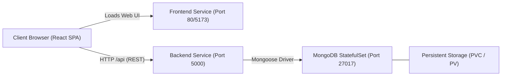

# DevOps End-to-End Production Project 🚀

A production-grade, decoupled full-stack cloud-native application built with **React (Vite)**, **Node.js (Express)**, and **MongoDB (Mongoose)** using a monorepo architecture. 

Engineered specifically as a comprehensive baseline for **DevOps automation**, **Containerization (Docker)**, **Continuous Integration/Continuous Delivery (CI/CD)**, **Kubernetes Orchestration (K8s)**, and **Infrastructure as Code (Terraform)**.

---

## 📑 Table of Contents

- [Features](#-features)
- [Architecture & Tech Stack](#-architecture--tech-stack)
- [Project Directory Structure](#-project-directory-structure)
- [Local Development Setup](#-local-development-setup)
- [Docker & Docker Compose](#-docker--docker-compose)
- [Kubernetes Deployment (K8s)](#-kubernetes-deployment-k8s)
  - [Manifest Architecture](#manifest-architecture)
  - [Deploying to Cluster](#deploying-to-cluster)
  - [Local Access & Port Forwarding](#local-access--port-forwarding)
  - [Production Ingress Considerations](#production-ingress-considerations)
- [Infrastructure as Code (Terraform)](#-infrastructure-as-code-terraform)
- [CI/CD Pipeline (GitHub Actions)](#-cicd-pipeline-github-actions)
- [Automated Testing](#-automated-testing)
- [Troubleshooting & Post-Mortem Reports](#-troubleshooting--post-mortem-reports)
- [Documentation Links](#-documentation-links)

---

## 🌟 Features

- **Decoupled Monorepo Architecture:** Frontend and backend maintain distinct dependency trees and build pipelines while living in a unified Git repository.
- **Persistent MongoDB Storage:** Complete CRUD capabilities via Mongoose ODM (`/api/items`) for creating and managing records.
- **Fault-Tolerant Degraded Mode:** If MongoDB is temporarily unavailable or restarting, the backend stays online, reporting degraded health status instead of crashing.
- **Real-Time Health Telemetry:** Live health endpoint at `GET /api/health` providing dynamic ISO timestamps, live server uptime, and database connection state.
- **Network Latency Measurement:** The client UI measures round-trip API latency in milliseconds via `performance.now()`.
- **Hardened Security:** Express protected with Helmet HTTP headers, configurable CORS origin whitelist, disabled `X-Powered-By` fingerprinting, and sanitized production error reporting.
- **Kubernetes Cloud-Native:** StatefulSet for MongoDB with persistent storage (`volumeClaimTemplates`), resilient readiness/liveness probes, decoupled Services, and resource boundaries (`requests` / `limits`).
- **100% Automated Test Coverage:** Comprehensive unit and integration test suites using **Vitest**, **React Testing Library**, and **Supertest** (21 passing tests).

---

## 🛠 Architecture & Tech Stack



### Stack Breakdown
- **Frontend:** React 18, Vite 6, Modern Pure CSS (Variables, Flexbox, Grid), Native Fetch API.
- **Backend:** Node.js (ES Modules), Express.js 4, Helmet, CORS, Mongoose ODM.
- **Database:** MongoDB 7.0+ (StatefulSet with Persistent Volume Claim).
- **Containerization:** Multi-stage Dockerfiles (`node:slim`, `mongo:latest`), Docker Compose.
- **Orchestration:** Kubernetes (KinD / EKS), StatefulSet, Deployments, Services (ClusterIP / NodePort), Ingress.
- **IaC:** Terraform modules for AWS VPC and AWS EKS.
- **CI/CD:** GitHub Actions (Automated linting, testing, and multi-architecture Docker image publishing).

---

## 📁 Project Directory Structure

```text
.
├── app/
│   ├── frontend/                 # Client Single Page Application (Vite + React)
│   │   ├── src/
│   │   │   ├── components/       # Header, Hero, StatusCard, Footer
│   │   │   ├── services/api.js   # Centralized Fetch API abstraction
│   │   │   ├── App.jsx           # Root component & telemetry state
│   │   │   └── App.css           # Pure CSS architecture
│   │   ├── tests/                # Vitest & Testing Library suites
│   │   ├── Dockerfile            # Container definition for Frontend
│   │   └── package.json
│   │
│   └── backend/                  # REST API Service (Node + Express + Mongoose)
│       ├── src/
│       │   ├── config/           # Environment validation & DB manager
│       │   ├── controllers/      # Health & MongoDB item controllers
│       │   ├── middleware/       # 404 handler & centralized error trap
│       │   ├── models/           # Mongoose schemas & data models
│       │   ├── routes/           # /api/health and /api/items routes
│       │   └── server.js         # Express setup, Helmet & CORS
│       ├── tests/                # Vitest & Supertest API integration suites
│       ├── Dockerfile            # Container definition for Backend
│       └── package.json
│
├── k8s/                          # Production-ready Kubernetes manifests
│   ├── 00-namespace.yaml         # Isolated 'devops-project' namespace
│   ├── 01-mongodb.yaml           # Headless Service & StatefulSet with 2Gi PVC
│   ├── 02-backend.yaml           # Deployment & NodePort Service (30001)
│   └── 03-frontend.yaml          # Deployment & NodePort Service (30081)
│
├── Terraform/                    # Infrastructure as Code
│   ├── main.tf                   # Root Terraform configuration
│   ├── variables.tf              # Input variables
│   ├── output.tf                 # Cluster endpoints and outputs
│   └── modules/
│       ├── vpc/                  # AWS VPC module (subnets, gateways, route tables)
│       └── eks/                  # AWS EKS cluster and managed node groups
│
├── .github/
│   └── workflows/
│       └── cicd.yaml             # GitHub Actions test, build & Docker Hub push
│
├── docs/                         # Technical architecture & API documentation
│   ├── architecture.md
│   ├── api-documentation.md
│   └── setup.md
│
├── report/                       # Diagnostic & Post-Mortem reports
│   ├── report.md                 # K8s deployment & KinD cluster diagnosis
│   └── report2.md                # Frontend port-forwarding & client networking analysis
│
├── docker-compose.yaml           # Local multi-container orchestration
├── package.json                  # Root monorepo orchestration scripts
└── README.md
```

---

## 💻 Local Development Setup

### 1. Prerequisites
- Node.js >= 18.x
- npm >= 9.x
- Docker & Docker Compose (optional for containerized run)
- `kubectl` & KinD / Minikube (for Kubernetes testing)

### 2. Dependency Installation
Install dependencies for both frontend and backend from the root directory:
```bash
# Backend dependencies
npm --prefix app/backend install

# Frontend dependencies
npm --prefix app/frontend install
```

### 3. Environment Variables
Both applications come with `.env.example` templates:
```bash
# Backend
cp app/backend/.env.example app/backend/.env

# Frontend
cp app/frontend/.env.example app/frontend/.env
```

### 4. Running the Development Servers
In two separate terminals:
```bash
# Terminal 1: Start Backend (Port 5000)
npm run dev:backend

# Terminal 2: Start Frontend (Port 5173)
npm run dev:frontend
```
Open **[http://localhost:5173](http://localhost:5173)** in your browser.

---

## 🐳 Docker & Docker Compose

To spin up the entire stack (MongoDB + Express Backend + React Frontend) with a single command:

```bash
docker compose up --build -d
```

- **Frontend:** [http://localhost:5173](http://localhost:5173)
- **Backend API:** [http://localhost:5000/api/health](http://localhost:5000/api/health)
- **MongoDB:** `localhost:27017`

To shut down and wipe ephemeral volumes:
```bash
docker compose down -v
```

---

## ☸️ Kubernetes Deployment (K8s)

### Manifest Architecture
The Kubernetes configuration in [k8s/](file:///home/kashifhm333/Desktop/Project/DevOps-end-to-end-production-Project-/k8s) decouples stateful storage from stateless application compute:
1. **[00-namespace.yaml](file:///home/kashifhm333/Desktop/Project/DevOps-end-to-end-production-Project-/k8s/00-namespace.yaml):** Creates the dedicated `devops-project` namespace.
2. **[01-mongodb.yaml](file:///home/kashifhm333/Desktop/Project/DevOps-end-to-end-production-Project-/k8s/01-mongodb.yaml):** Headless `mongodb-service` and a single-replica `StatefulSet` with dynamic `volumeClaimTemplates` (`2Gi` local-path storage).
3. **[02-backend.yaml](file:///home/kashifhm333/Desktop/Project/DevOps-end-to-end-production-Project-/k8s/02-backend.yaml):** Backend deployment connecting to `mongodb-service:27017`, equipped with readiness probe on `/api/health` and exposed via NodePort `30001`.
4. **[03-frontend.yaml](file:///home/kashifhm333/Desktop/Project/DevOps-end-to-end-production-Project-/k8s/03-frontend.yaml):** Stateless React deployment serving on port `5173`/`80`, exposed via NodePort `30081`.

### Deploying to Cluster
```bash
kubectl apply -f k8s/
```

Verify that all pods reach `1/1 Running`:
```bash
kubectl get pods -n devops-project
```

### Local Access & Port Forwarding
> [!IMPORTANT]
> **Understanding React Client-Side Execution:**
> React runs inside your **client browser on your laptop**, not inside the cluster pod. When the browser makes a request, it calls `VITE_API_URL`.
> If testing locally via `kubectl port-forward`, **both services must be forwarded simultaneously**:

```bash
# Terminal 1: Forward Frontend to localhost:8080
kubectl port-forward svc/frontend-service 8080:80 -n devops-project

# Terminal 2: Forward Backend to localhost:30001 (matching VITE_API_URL)
kubectl port-forward svc/backend-service 30001:5000 -n devops-project
```
Now visit **[http://localhost:8080](http://localhost:8080)**. Both Backend and MongoDB telemetry cards will show **Connected / Operational**.

### Production Ingress Considerations
In a production cloud cluster (EKS/GKE):
- Do **not** expose NodePorts directly. Change Services to `type: ClusterIP`.
- Deploy an **Ingress Controller** (NGINX / AWS ALB) that maps:
  - `https://yourdomain.com/` ➔ `frontend-service:80`
  - `https://yourdomain.com/api/*` ➔ `backend-service:5000`
- Set `VITE_API_URL` to `/api` (relative path), eliminating port numbers and CORS requirements.

---

## 🏗 Infrastructure as Code (Terraform)

Located in [Terraform/](file:///home/kashifhm333/Desktop/Project/DevOps-end-to-end-production-Project-/Terraform), modular Terraform scripts provision cloud infrastructure for the Kubernetes workload:

- **VPC Module (`modules/vpc`):** Multi-AZ public and private subnets, NAT Gateways, Internet Gateway, and route tables.
- **EKS Module (`modules/eks`):** Managed AWS EKS Control Plane, OIDC Provider, IAM cluster roles, and autoscaling Managed Node Groups.

---

## 🔄 CI/CD Pipeline (GitHub Actions)

The pipeline defined in `.github/workflows/cicd.yaml` automates the release lifecycle:
1. **Automated Testing:** Checks out code, configures Node.js, installs dependencies, and runs `npm test` across frontend and backend.
2. **Docker Buildx & Authentication:** Authenticates against Docker Hub using GitHub encrypted secrets (`DOCKERHUB_USERNAME`, `DOCKERHUB_PASSWORD`).
3. **Container Image Publication:** Builds and pushes multi-platform Docker images:
   - `<username>/devops_end_to_end_project-backend:latest`
   - `<username>/devops_end_to_end_project-frontend:latest`

---

## 🧪 Automated Testing

Execute the full monorepo automated test suite:
```bash
npm test
```

### Test Breakdown
- **Backend Tests (14 passed):**
  - Uptime and ISO timestamp calculation (`/api/health`).
  - Security headers verification (Helmet XSS, nosniff, frameguard).
  - MongoDB connection failure degradation (503 status code when DB is offline).
  - Item CRUD operations (GET, POST, DELETE, validation handling).
- **Frontend Tests (7 passed):**
  - DOM and navigation rendering.
  - Telemetry state machine (Loading, Connected, Disconnected).
  - Live round-trip response time measurement.
  - Form submission and record deletion.

---

## 📋 Troubleshooting & Post-Mortem Reports

Detailed diagnostic reports documenting real-world challenges encountered during development and deployment are archived in `report/`:
- **[report/report.md](file:///home/kashifhm333/Desktop/Project/DevOps-end-to-end-production-Project-/report/report.md):** Diagnosis of Kubernetes namespace terminating deadlocks, KinD multi-node Docker image isolation, and manifest schema validation fixes.
- **[report/report2.md](file:///home/kashifhm333/Desktop/Project/DevOps-end-to-end-production-Project-/report/report2.md):** Deep-dive analysis on frontend port-forwarding, client-side SPA networking, and NodePort reachability from local browsers.

---

## 📚 Documentation Links

- [Architecture Design & Data Flow](file:///home/kashifhm333/Desktop/Project/DevOps-end-to-end-production-Project-/docs/architecture.md)
- [REST API Contracts & Payloads](file:///home/kashifhm333/Desktop/Project/DevOps-end-to-end-production-Project-/docs/api-documentation.md)
- [Local Setup & Development Guide](file:///home/kashifhm333/Desktop/Project/DevOps-end-to-end-production-Project-/docs/setup.md)
