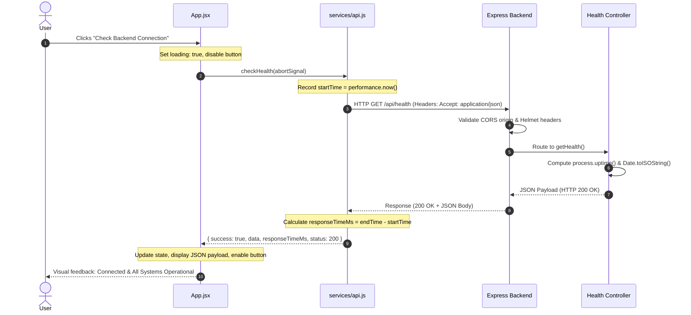
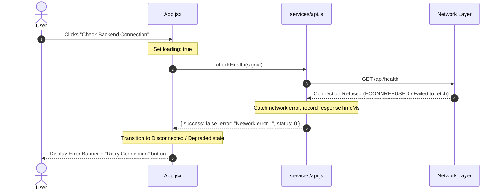

# Architecture Overview

This document describes the architectural design, component responsibilities, communication flow, and request lifecycle for the **DevOps Starter** application.

---

## 1. High-Level Architecture

The DevOps Starter application is built as a **decoupled full-stack monorepo**. It separates client presentation from backend service logic while keeping all code in a single repository for cohesive version control and developer ergonomics.

```
+-------------------------------------------------------------------------+
|                               Client Tier                               |
|                                                                         |
|   +-----------------------------------------------------------------+   |
|   |                  React 18 Single Page App (SPA)                |   |
|   |                                                                 |   |
|   |   +------------+  +-----------------+  +--------------------+   |   |
|   |   | Header.jsx |  |    Hero.jsx     |  |   StatusCard.jsx   |   |   |
|   |   +------------+  +-----------------+  +--------------------+   |   |
|   |                                                                 |   |
|   |   +---------------------------------------------------------+   |   |
|   |   |              Centralized API Service (api.js)           |   |   |
|   |   +---------------------------------------------------------+   |   |
|   +--------------------------------|--------------------------------+   |
+------------------------------------|------------------------------------+
                                     |
                          HTTP / Fetch API (REST)
                        CORS Preflight + GET /api/health
                                     |
                                     v
+-------------------------------------------------------------------------+
|                               Server Tier                               |
|                                                                         |
|   +-----------------------------------------------------------------+   |
|   |                       Express.js REST API                       |   |
|   |                                                                 |   |
|   |   +--------------------+    +-------------------------------+   |   |
|   |   | Security & CORS    | -> | Health Controller             |   |   |
|   |   | Helmet, JSON Parse |    | (Uptime, Timestamp, Status)   |   |   |
|   |   +--------------------+    +-------------------------------+   |   |
|   |             |                                                   |   |
|   |             v                                                   |   |
|   |   +---------------------------------------------------------+   |   |
|   |   |        Centralized Error Handler & 404 Route Trap       |   |   |
|   |   +---------------------------------------------------------+   |   |
|   +-----------------------------------------------------------------+   |
+-------------------------------------------------------------------------+
```

---

## 2. Directory Structure & Monorepo Boundaries

```text
devops-practice-app/
│
├── app/
│   ├── frontend/                 # Client SPA (React 18 + Vite)
│   │   ├── public/               # Static assets & SVG icons
│   │   ├── src/
│   │   │   ├── components/       # Reusable, self-contained UI components
│   │   │   │   ├── Header.jsx    # Top navigation & mobile responsive drawer
│   │   │   │   ├── Hero.jsx      # Primary value proposition & CTAs
│   │   │   │   ├── StatusCard.jsx# Telemetry display & metric cards
│   │   │   │   └── Footer.jsx    # Semantic footer & metadata
│   │   │   ├── services/
│   │   │   │   └── api.js        # Centralized HTTP client using Fetch API
│   │   │   ├── App.jsx           # Root layout, telemetry state management
│   │   │   ├── App.css           # Modern CSS styling (no framework bloat)
│   │   │   └── main.jsx          # React DOM entry point
│   │   ├── tests/                # Automated component tests (Vitest + JSDOM)
│   │   ├── index.html            # HTML shell with accessibility metadata
│   │   ├── vite.config.js        # Vite bundler & test configuration
│   │   └── package.json          # Frontend dependencies & scripts
│   │
│   └── backend/                  # REST API Service (Node.js + Express)
│       ├── src/
│       │   ├── routes/
│       │   │   └── health.routes.js     # Health route declarations
│       │   ├── controllers/
│       │   │   └── health.controller.js # Endpoint business logic & uptime
│       │   ├── middleware/
│       │   │   └── error.middleware.js  # 404 trap & global error handler
│       │   ├── config/
│       │   │   └── config.js            # Environment validation & freezing
│       │   └── server.js                # App orchestration & HTTP listener
│       ├── tests/                # API integration tests (Supertest + Vitest)
│       ├── package.json          # Backend dependencies & scripts
│       ├── .env.example          # Environment variable template
│       └── .env                  # Local runtime environment file
│
├── docs/                         # Engineering & operational documentation
│   ├── architecture.md           # Architecture, flow & lifecycle (this file)
│   ├── api-documentation.md      # API spec, sample payloads, error contracts
│   └── setup.md                  # Development setup & verification guide
│
├── .gitignore                    # Git exclusions
├── package.json                  # Root monorepo orchestration scripts
└── README.md                     # Project overview & quickstart
```

---

## 3. Component Responsibilities

### Frontend Tier (`app/frontend`)

| Component / Module | Responsibility |
| :--- | :--- |
| **`main.jsx`** | Mounts React tree into `#root` DOM container inside `React.StrictMode`. |
| **`App.jsx`** | Orchestrates layout, manages asynchronous state (`healthState`, client uptime), coordinates health checks, handles duplicate request locking and abort cleanup. |
| **`Header.jsx`** | Accessible navigation bar supporting smooth anchor scrolling and a responsive mobile drawer with keyboard traps (`Esc` listener). |
| **`Hero.jsx`** | Displays mission statement, badges, and primary action buttons. |
| **`StatusCard.jsx`** | Reusable card for telemetry metrics with accessible status pill indicators (`healthy`, `loading`, `danger`, `warning`). |
| **`Footer.jsx`** | Semantic footer displaying application copyright, dynamic year, and technology stack. |
| **`services/api.js`** | Centralized API communication layer. Reads `VITE_API_URL`, measures round-trip latency (`performance.now()`), formats headers, and normalizes errors. |

### Backend Tier (`app/backend`)

| Component / Module | Responsibility |
| :--- | :--- |
| **`server.js`** | Bootstraps Express, attaches Helmet security headers, configures CORS whitelist, mounts routes, attaches 404/error middleware, and initiates HTTP listener with graceful shutdown (`SIGTERM`, `SIGINT`). |
| **`config/config.js`** | Loads `.env` via `dotenv`, validates port number ranges and valid execution environments (`NODE_ENV`), and exports a frozen configuration object. |
| **`routes/health.routes.js`** | Exposes router mapping `GET /health` to the health controller. |
| **`controllers/health.controller.js`** | Produces dynamic runtime metadata: calculates server uptime (`process.uptime()`), generates ISO-8601 timestamps, and returns standard JSON payloads. |
| **`middleware/error.middleware.js`** | Intercepts non-existent routes (404) and uncaught server errors (500). Strips stack traces in production to prevent information leakage. |

---

## 4. API Communication Flow

The frontend never embeds raw `fetch()` calls inside individual presentation components. Instead, all communication passes through `services/api.js`.



---

## 5. Failure Detection & Resilience Flow

When the backend is offline or an error occurs:



---

## 6. Security Architecture

1. **Origin Restriction (CORS):** The backend only allows origins defined in `FRONTEND_URL` and local development origins.
2. **HTTP Security Headers (Helmet):** Configures Content Security Policy (CSP), prevents MIME-type sniffing (`X-Content-Type-Options: nosniff`), sets clickjacking protection (`X-Frame-Options: SAMEORIGIN`), and enforces HSTS.
3. **Fingerprinting Disablement:** `app.disable('x-powered-by')` removes the default Express signature header.
4. **Environment Isolation:** Secrets and URLs are externalized in `.env` files and never committed to source control.
5. **Safe Error Handling:** Production mode (`NODE_ENV=production`) suppresses stack traces and returns generic error messages to prevent internal system leaks.

