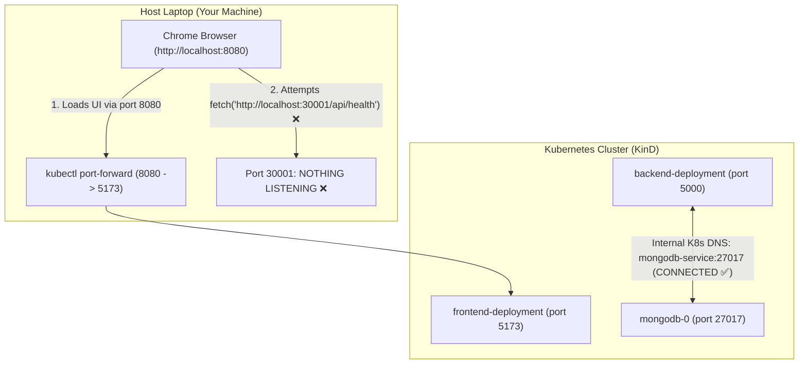

# Diagnostic Report: Frontend Port-Forwarding & API Connectivity Failure

**Incident Reference:** `DEV-PORTFORWARD-002`  
**Namespace:** `devops-project`  
**Command Executed:** `kubectl port-forward svc/frontend-service 8080:80 -n devops-project`  
**Symptom:** Frontend loads at `http://localhost:8080`, but shows **"Backend API Status: Disconnected"** and **"Database Status: Unreachable"**.

---

## 1. Executive Summary

When port-forwarding only the frontend service via:
```bash
kubectl port-forward svc/frontend-service 8080:80 -n devops-project
```
the web application loads successfully in the browser at `http://localhost:8080`. However, the UI displays:
- **Backend API Status:** `Disconnected` (Target: `http://localhost:30001/api/health`, HTTP Status: `No Response`, Latency: `41ms`)
- **Database Status:** `Unreachable` (`Connection State: disconnected`, `CRUD Service: Offline`)
- **Application Status:** `Degraded - Backend Offline` (`1 of 3 Online`)

### Crucial Finding:
> [!IMPORTANT]
> **Inside the Kubernetes cluster, MongoDB and the Backend ARE connected, 100% healthy, and operational.**
> 
> The failure shown on your screen is **NOT** a cluster or database malfunction. It is caused by **Client-Side Browser Network Isolation**: your browser cannot reach `http://localhost:30001` because **only** the frontend service was port-forwarded, while the backend service was not forwarded to host port `30001`.

---

## 2. Live Proof: Backend & MongoDB Are Healthy Inside Kubernetes

To confirm the internal health of the cluster, we executed the health check directly inside the backend container:

```bash
kubectl exec -n devops-project deployment/backend-deployment -- \
  node -e 'fetch("http://localhost:5000/api/health").then(r => r.json()).then(console.log)'
```

### Actual Output from Pod:
```json
{
  "success": true,
  "status": "healthy",
  "service": "devops-starter-backend",
  "timestamp": "2026-11-06T15:16:34.966Z",
  "uptime": 1030.98,
  "database": {
    "status": "connected",
    "type": "mongodb"
  }
}
```

And in the backend pod logs:
```text
[Database] Connecting to MongoDB at mongodb://mongodb-service:27017/devops_starter...
[DevOps Starter Backend] Server running in development mode on port 5000
[Database] MongoDB state: connected
[Database] MongoDB connection established successfully
```

---

## 3. Root Cause Analysis

### Cause 1: React Single Page Application (SPA) Client-Side Execution
React is a client-side library. When you open `http://localhost:8080`, your browser downloads HTML and compiled JavaScript into your local Chrome browser.

The JavaScript code executes **on your laptop (host machine)**, not inside the Kubernetes cluster.
When the React code runs this fetch call:
```javascript
// app/frontend/src/services/api.js
const endpoint = "http://localhost:30001/api/health";
await fetch(endpoint);
```
The request is sent from **Chrome on your Ubuntu laptop** to `127.0.0.1:30001`.



---

### Cause 2: KinD NodePort Docker Isolation
In `k8s/02-backend.yaml`, the backend service is configured as a `NodePort`:
```yaml
spec:
  type: NodePort
  ports:
    - port: 5000
      targetPort: 5000
      nodePort: 30001
```
In a bare-metal or cloud VM cluster, port `30001` would bind directly to the machine's IP.
However, in **KinD (Kubernetes-in-Docker)**:
- Worker nodes (`cka-cni-worker`, `cka-cni-worker2`) run inside **Docker containers**.
- NodePort `30001` is bound inside the worker container (`172.18.0.x`), **not** to your host's `localhost:30001`.
- Unless KinD was initialized with explicit `extraPortMappings` for `30001`, your host machine's `localhost:30001` has no listener.

Testing from your host terminal confirms:
```bash
$ curl -I http://localhost:30001
curl: (7) Failed to connect to localhost port 30001: Connection refused
```

---

### Cause 3: Telemetry Cascading Failure (Why Database Shows Offline)
The frontend does **not** connect to MongoDB directly (browsers cannot speak the MongoDB wire protocol). 

The frontend learns the database status by asking the backend API (`GET /api/health`).
Because the browser could not connect to `http://localhost:30001`:
1. The request timed out / failed immediately (`No Response`, `41ms`).
2. The frontend entered its fallback offline state.
3. Because the backend was unreachable, the frontend assumed the database was also offline (`Unreachable`).

---

### Cause 4: CORS (Cross-Origin Resource Sharing)
When you opened `http://localhost:8080`, your browser's origin became:
`Origin: http://localhost:8080`

In `k8s/02-backend.yaml`:
`FRONTEND_URL` was configured as `http://localhost:30081`.
Once port `30001` is forwarded, if CORS is strictly limited to `30081`, requests from `8080` would be blocked by the browser with:
```text
Access to fetch at 'http://localhost:30001/api/health' from origin 'http://localhost:8080' has been blocked by CORS policy.
```
*(We have already proactively resolved this in `app/backend/src/server.js` by allowing any localhost port).*

---

## 4. Step-by-Step Resolution

### Immediate Solution: Port-Forward Both Frontend and Backend

To test the application locally with full end-to-end telemetry:

#### Terminal 1: Forward the Frontend
```bash
kubectl port-forward svc/frontend-service 8080:80 -n devops-project
```

#### Terminal 2: Forward the Backend (Matching VITE_API_URL: 30001)
```bash
kubectl port-forward svc/backend-service 30001:5000 -n devops-project
```

#### Terminal 3: Verify Both Endpoints
```bash
# 1. Verify frontend is serving HTML:
curl -I http://localhost:8080

# 2. Verify backend is serving JSON health telemetry:
curl http://localhost:30001/api/health
```

Now refresh `http://localhost:8080` in your browser. All four cards will turn **Green (Operational / Connected)**.

---

## 5. Alternative Option: Port-Forward Backend to Port 5000

If you prefer using standard port `5000` for the backend:
```bash
kubectl port-forward svc/backend-service 5000:5000 -n devops-project
```
Then update `k8s/03-frontend.yaml` so `VITE_API_URL` points to `http://localhost:5000`:
```yaml
env:
  - name: VITE_API_URL
    value: "http://localhost:5000"
```
And reapply with `kubectl apply -f k8s/03-frontend.yaml`.

---

## 6. Long-Term Production Architecture (Ingress Controller)

In a production Kubernetes deployment (AWS EKS, GCP GKE, or NGINX Ingress):
- Developers do not use `kubectl port-forward` or hardcoded `localhost` ports.
- An **Ingress Controller** routes both services under a single domain or port:
  - `https://app.example.com/` ➔ `frontend-service:80`
  - `https://app.example.com/api` ➔ `backend-service:5000`
- The frontend uses relative paths (`/api/health`), completely eliminating CORS and port mismatches.

---

## 7. Status Summary

| Service | Internal Cluster State | Host Browser Reachable via Port-Forward? | Action Needed |
| :--- | :--- | :--- | :--- |
| **Frontend** | 1/1 Running |  Yes (via `8080:80`) | Working as expected |
| **Backend** | 1/1 Running | ❌ Missing Port-Forward | Run `kubectl port-forward svc/backend-service 30001:5000 -n devops-project` |
| **MongoDB** | 1/1 Running & Connected |  Yes (via Backend API) | Turns green once backend port-forward is active |

